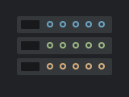

# 声核横向机架调音台

把每个通道做成横向机架行，集中显示效果器、发送、音量和电平。

当前源码版本：**0.1.4**。网页界面，适用于 Windows x64 声核。



## 界面与操作

- 通道按横向机架行排列，避免所有信息挤在窄通道条里。
- 点击通道标题打开通道设置，拖动标题调整顺序。
- 从发送入口拖向目标通道或侧链效果器建立路由。

- 界面语言：中文、英文、日文。
- 主题：暗色、亮色。

## 安装

[先下载声核](https://audcore.utae.cn/download/)

在支持网页皮肤的声核中打开构建生成的 `.skin.audcore` 文件，再到皮肤设置选择「机架调音台」。

所需网页接口为 Skin API 1.0；音频处理、设备配置和工程保存由宿主负责。

公开源码不代表已经更新官方在线版本，下载仍以官方签名列表为准。

## 从源码生成安装包

使用 Node.js **24.12.0**，无需安装 npm 依赖。

```sh
git clone https://github.com/audcore/audcore-skin-rack-mixer.git
cd audcore-skin-rack-mixer
node --test tests/page.test.mjs tools/build-package.test.mjs
node tools/build-package.mjs . dist
```

最终安装包：

`dist/cn.audcore.rack-mixer-v0.1.4.skin.audcore`

打包器从 manifest.json 的文件清单读取资源，生成 ZIP 格式皮肤包。宿主运行所需的资源全部随包交付。

## 开发与反馈

- [声核官网](https://audcore.utae.cn/)
- [声核使用指北](https://audcore.utae.cn/guide/)
- [skin-dev：SDK、接口资料与模拟开发工具](https://audcore.utae.cn/skin-dev/)
- [皮肤开发指引](https://github.com/audcore/audcore-document/blob/main/docs/皮肤开发指引.md)
- [manifest 与构建发布规范](https://github.com/audcore/audcore-document/blob/main/docs/皮肤发布规范.md)
- [所有皮肤的源码列表](https://github.com/audcore/audcore-document/blob/main/skins.md)
- [此皮肤的问题反馈](https://github.com/audcore/audcore-skin-rack-mixer/issues)
- [声核本体的问题反馈](https://github.com/audcore/audcore-document/issues)

修改名称、版本、语言或构建规则时编辑根目录 manifest.json；界面源码和资源按清单维护。每款皮肤只在自己的仓库更新，构建输入无变化时跳过。

## 许可证与验证范围

自有代码采用 [MIT 许可证](LICENSE)。系统字体只按名称引用，不随包分发。

- 已验证独立打包、资源引用、重复打包一致性及上述测试。
- 本轮仓库改名与说明整理没有重新编译或替换在线皮肤包。
- 未重新启动宿主进行窗口、鼠标交互或跨屏验收。
